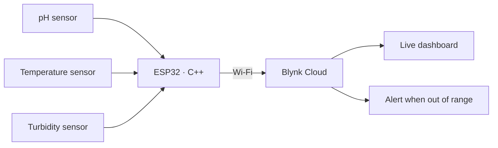

  

  <h1>Michael Jhoncary</h1>

  
<strong>Electrical Engineering student at Universitas Pendidikan Indonesia. I build sensor and IoT prototypes, then analyze the data they produce.</strong>

  

    R&amp;D Staff, IEEE UPI Student Branch · Bandung, Indonesia
  

  

    
    
  

---

I started in software. I studied Computer Software Engineering at SMK Gracia (2021 to 2023) and did a front-end internship at CyberLabs in 2022. In 2024 I moved to Electrical Engineering at UPI, and most of my projects since then sit where hardware meets code: an ESP32 reading water sensors, an FM transmitter built from discrete parts, and Python notebooks that make sense of measurements.

- **Now:** Research and Development Staff at IEEE UPI Student Branch (since Aug 2026), working on project feasibility and prototypes.
- **Before:** Media and Publication Staff at Himpunan Mahasiswa Elektro UPI (Aug 2025 to May 2026), where I ran the EGC graphics program and the HME website.
- **Certified:** freeCodeCamp Data Analysis with Python (Jun 2026).

## Featured: Real-Time Water Quality Monitoring

<table>
  <tr>
    <td width="62%" valign="top">
      

        Team project, Dec 2025 to Jan 2026. Analog and digital sensors measure <strong>pH, temperature, and turbidity</strong>. An <strong>ESP32</strong> programmed in <strong>C++</strong> reads them and sends the data over Wi-Fi to <strong>Blynk</strong>. The Blynk dashboard shows live readings and sends an alert when a value leaves its safe range.
      

      

        The system sent readings continuously during testing. Two problems took most of the debugging time: calibrating the pH sensor, and keeping the Wi-Fi connection stable.
      

      

        
      

    </td>
    <td width="38%" valign="top">
      <strong>Stack</strong>  
      ESP32 · C++ 
      pH, temperature, turbidity sensors 
      Wi-Fi to Blynk Cloud 
      Dashboard and threshold alerts
    </td>
  </tr>
</table>

## Hardware and Lab Work

**Mini FM Transmitter** (Oct to Dec 2025). A transmitter built from a transistor, resistors, capacitors, a hand-wound coil, a microphone, and an antenna. An LC oscillator generates the carrier, the microphone signal modulates its frequency, and a transistor stage amplifies it before the antenna. A regular FM radio tuned to the same frequency plays the audio back.

  
<strong>Coursework studies (2024)</strong>

   

  | Study | What I did |
  |---|---|
  | Liquid cooling for electronics | Compared nanofluids and water-glycol mixtures using the Hagen–Poiseuille equation and heat transfer principles |
  | Microplastic separation | Compared sedimentation, flotation, hydrocyclone, and filtration; the best result came from a dual-inlet hydrocyclone at 70 ml/s |
  | Conveyor kinematics | Modeled constant-velocity and constant-acceleration motion of a conveyor with the PhET Moving Man simulation |

## Code on GitHub

<table>
  <tr>
    <td width="50%" valign="top">
      <h3>Resiscolor</h3>
      
<strong>4-band resistor calculator</strong> · Nov to Dec 2024

      

        Pick the four color bands and the page shows the resistance and tolerance. Built as a team project in Teknik Elektro with plain HTML, CSS, and JavaScript, and deployed on Vercel.
      

      

        <a href="https://github.com/mjhoncaryy/Resiscolor_4_Bands_Calculator_Resistor"><strong>Repository</strong></a>
        &nbsp;·&nbsp;
        <a href="https://resiscolor.vercel.app"><strong>Live demo</strong></a>
      

    </td>
    <td width="50%" valign="top">
      <h3>Data Analysis with Python</h3>
      
<strong>freeCodeCamp certification projects</strong> · 2026

      

        Four required projects built with Pandas, NumPy, Matplotlib, and Seaborn:
        <a href="https://github.com/mjhoncaryy/Sea_Level_Predictor">Sea Level Predictor</a> (linear regression on EPA sea-level data),
        <a href="https://github.com/mjhoncaryy/Medical_Data_Visualizer">Medical Data Visualizer</a>,
        <a href="https://github.com/mjhoncaryy/Page_View_Time_Series_Visualizer">Page View Time Series Visualizer</a>, and
        <a href="https://github.com/mjhoncaryy/Demographic_Data_Analyzer">Demographic Data Analyzer</a>.
      

    </td>
  </tr>
</table>

  
<strong>Web projects</strong>

   

  | Project | Notes |
  |---|---|
  | [Income–Expense Tracker v1.3](https://github.com/mjhoncaryy/income-expense-tracker-v1.3) | Monorepo with a React + Vite frontend (mock data for now), a backend in progress, and shared Zod schemas |
  | [Campwise](https://github.com/mjhoncaryy/campwise-landing-page) | Frontend-only camping rental site with Next.js 16, React 19, TypeScript, and Tailwind CSS 4 |

## Tools

  
  &nbsp;
  
  &nbsp;
  
  &nbsp;
  
  &nbsp;
  
  &nbsp;
  
  &nbsp;
  
  &nbsp;
  
  &nbsp;
  
  &nbsp;
  

| Area | Tools and skills |
|---|---|
| Embedded and IoT | ESP32, C++, analog and digital sensors, Blynk, sensor calibration |
| Circuits | PCB design, Proteus, discrete RF circuits (LC oscillator, transistor amplifier) |
| Data | Python, Pandas, NumPy, Matplotlib, Seaborn, SQL, regression |
| Web | HTML, CSS, JavaScript, TypeScript, React, Next.js, PHP, Laravel |
| Design | Adobe Photoshop, Adobe Illustrator |

## Next

- Fix the two weak points from the water-quality build: a repeatable pH calibration routine and automatic Wi-Fi reconnection.
- Put the firmware and wiring of my hardware projects on GitHub, not only the write-ups.
- Build prototypes with the R&D team at IEEE UPI Student Branch.

---

  
Interested in embedded systems, IoT, or student research collaboration? Message me on <a href="https://www.linkedin.com/in/michaeljhoncary/">LinkedIn</a>.

