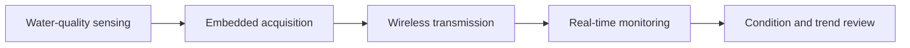

  

  <h1>Michael Jhoncary</h1>

  
<strong>Building measurable systems from sensors, circuits, and data.</strong>

  

    Electrical Engineering · Embedded Systems · Internet of Things · Instrumentation
  

  

    
    
  

---

Electrical Engineering undergraduate at **Universitas Pendidikan Indonesia** with a growing focus on embedded sensing, connected devices, and engineering data.

My work explores the path from a physical condition to useful information:

  <code>SENSE</code> &nbsp;→&nbsp; <code>ACQUIRE</code> &nbsp;→&nbsp; <code>TRANSMIT</code> &nbsp;→&nbsp; <code>INTERPRET</code> &nbsp;→&nbsp; <code>IMPROVE</code>

## Engineering Focus

<table>
  <tr>
    <td width="33%" align="center" valign="top">
        
      <strong>Embedded Systems</strong> 
      Microcontroller-based prototypes, device logic, and hardware–software integration.
    </td>
    <td width="33%" align="center" valign="top">
        
      <strong>IoT & Connectivity</strong> 
      Sensor-to-network workflows, real-time monitoring, and connected-system architecture.
    </td>
    <td width="34%" align="center" valign="top">
        
      <strong>Engineering Data</strong> 
      Measurement interpretation, visualization, validation, and technical reporting.
    </td>
  </tr>
</table>

## Featured System

<table>
  <tr>
    <td width="68%" valign="top">
      <h3>Real-Time IoT-Based Water Quality Monitoring System</h3>
      

        An applied IoT project developed to observe water-quality conditions continuously and present the readings through a real-time monitoring workflow.
      

      

        The project connects physical sensing, embedded data acquisition, wireless communication, and a readable monitoring layer. Its main engineering value lies in designing a complete path from environmental measurement to information that can be reviewed remotely.
      

      

        
      

    </td>
    <td width="32%" valign="top">
      <strong>Engineering scope</strong>  
      ◉ Environmental sensing 
      ◉ Real-time acquisition 
      ◉ Embedded processing 
      ◉ Wireless data flow 
      ◉ Monitoring interface 
      ◉ System integration
    </td>
  </tr>
</table>

## Selected Work

<table>
  <tr>
    <td width="50%" valign="top">
      <h3>⚡ Resiscolor</h3>
      
<strong>Four-Band Resistor Calculator</strong>

      

        A practical electronics learning tool that converts resistor color bands into resistance and tolerance values through a clear interactive workflow.
      

      

        
        
      

      

        <a href="https://github.com/mjhoncaryy/Resiscolor_4_Bands_Calculator_Resistor"><strong>Repository</strong></a>
        &nbsp;·&nbsp;
        <a href="https://resiscolor.vercel.app"><strong>Live demo</strong></a>
      

    </td>
    <td width="50%" valign="top">
      <h3>📈 Sea Level Predictor</h3>
      
<strong>Engineering Data Study</strong>

      

        A quantitative study using historical measurements, linear regression, and visualization to examine long-term sea-level trends.
      

      

        
        
      

      

        <a href="https://github.com/mjhoncaryy/Sea_Level_Predictor"><strong>Repository</strong></a>
      

    </td>
  </tr>
</table>

  
<strong>More repositories and supporting software work</strong>

   

  | Project | Engineering value |
  |---|---|
  | [Medical Data Visualizer](https://github.com/mjhoncaryy/Medical_Data_Visualizer) | Data cleaning, correlation, and technical visualization |
  | [Page View Time Series Visualizer](https://github.com/mjhoncaryy/Page_View_Time_Series_Visualizer) | Time-series interpretation and trend communication |
  | [Demographic Data Analyzer](https://github.com/mjhoncaryy/Demographic_Data_Analyzer) | Structured analysis and evidence-based reporting |
  | [Income–Expense Tracker v1.3](https://github.com/mjhoncaryy/income-expense-tracker-v1.3) | Modular architecture, shared data contracts, and testing |
  | [Campwise](https://github.com/mjhoncaryy/campwise-landing-page) | Interface design and accessible application development |

## Engineering Workflow

<table>
  <tr>
    <td width="20%" align="center"><strong>01</strong> Define the problem</td>
    <td width="20%" align="center"><strong>02</strong> Design the system</td>
    <td width="20%" align="center"><strong>03</strong> Build the prototype</td>
    <td width="20%" align="center"><strong>04</strong> Validate the data</td>
    <td width="20%" align="center"><strong>05</strong> Document and iterate</td>
  </tr>
</table>

## Technical Toolbox

  
  &nbsp;&nbsp;
  
  &nbsp;&nbsp;
  
  &nbsp;&nbsp;
  
  &nbsp;&nbsp;
  
  &nbsp;&nbsp;
  
  &nbsp;&nbsp;
  
  &nbsp;&nbsp;
  
  &nbsp;&nbsp;
  

<table>
  <tr>
    <td><strong>Embedded & IoT</strong></td>
    <td>Microcontrollers · sensor integration · real-time acquisition · wireless monitoring</td>
  </tr>
  <tr>
    <td><strong>Data & analysis</strong></td>
    <td>Python · Pandas · Matplotlib · SciPy · regression · visualization</td>
  </tr>
  <tr>
    <td><strong>Supporting software</strong></td>
    <td>JavaScript · TypeScript · React · Next.js · interface development</td>
  </tr>
  <tr>
    <td><strong>Engineering practice</strong></td>
    <td>Git · testing · system decomposition · technical documentation</td>
  </tr>
</table>

## Current Direction

- Improving sensor calibration, measurement validation, and experimental documentation.
- Developing more complete embedded and IoT prototypes with reproducible test results.
- Strengthening the connection between electronics, instrumentation, and data interpretation.
- Contributing to student research and IEEE-oriented engineering activities.

---

  
<strong>Open to collaborative work in electronics, embedded systems, IoT, instrumentation, and engineering research.</strong>

  

    <a href="https://www.linkedin.com/in/michaeljhoncary/">LinkedIn</a>
    &nbsp;·&nbsp;
    <a href="https://github.com/mjhoncaryy?tab=repositories">All repositories</a>
  

